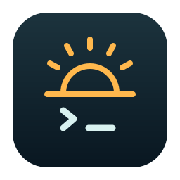

<div align="center">



# Agent Awake

**Let your agents work. Let your Mac rest.**

A native macOS menu-bar app that keeps your Mac awake for coding agents and remote terminals.

[Website & setup guide](https://irshatharis.github.io/agent-awake/) · [Download for Mac](https://github.com/irshatharis/agent-awake/releases/download/v0.1.5/Agent-Awake-0.1.5-macos-universal.dmg) · [Installation & setup](#install-on-your-mac) · [Release notes](https://github.com/irshatharis/agent-awake/releases/tag/v0.1.5) · [Report an issue](https://github.com/irshatharis/agent-awake/issues)

macOS 14+ · Apple Silicon & Intel · Free · MIT · Local only

</div>

> **Preview release · v0.1.5.** The download is ad-hoc signed, **not Apple-notarized**.
> macOS may block the first launch; follow the opening instructions below. Automatic
> detection has known gaps. For continuous remote access, use a timed or indefinite
> session. Closed-lid protection requires the approved helper and a check on your Mac.

## What it does

- **Pick a duration:** 15 minutes, 30 minutes, one hour, two hours, or a custom duration
  from one minute to seven days.
- **Stay awake indefinitely:** keep a terminal available between tasks until you end
  the session. Agent Awake does not set up SSH, Tailscale, or other remote access.
- **Follow agent activity:** Claude Code sessions are detected automatically from the
  status files Claude writes, including permission waits, interruptions, and background
  shells. Optional hooks track Codex CLI sessions, tools, permission waits, and subagents.
  An open process alone never counts as work; there are no CPU or screen-scraping heuristics.
- **Work with the lid closed:** the approved helper prevents lid sleep on battery and
  charger. It requests display sleep when the lid closes, including external displays.
- **Return to ordinary sleep:** observed completion gets an eight-second grace period
  by default. **Allow sleep now** ends manual sessions and pauses automatic mode.
- **Control battery use:** optional battery cutoff, configurable grace period, and
  launch at login. Battery cutoff is off by default.
- **Recover power settings:** renewable leases and a recovery journal restore owned
  changes after a disconnect or crash, provided macOS can run the helper.

## Install on your Mac

### 1. Download and move to Applications

1. [Download Agent Awake v0.1.5](https://github.com/irshatharis/agent-awake/releases/download/v0.1.5/Agent-Awake-0.1.5-macos-universal.dmg).
2. Open the DMG and drag **Agent Awake.app** onto **Applications**.
3. Eject the disk image. Open **Agent Awake** from **Applications**, not from the DMG.
4. Look for the sun or moon icon in your menu bar. **The app does not appear in the Dock**.
   Click the icon, then the gear for Settings.

The universal binary contains both Apple Silicon and Intel executables. Development
and physical checks were performed on Apple Silicon; Intel hardware and older supported
macOS versions have not been physically tested. See [verification](docs/VERIFICATION.md).

### 2. If macOS blocks the first launch

This preview does not have a Developer ID certificate or Apple notarization. Download
only from this repository's GitHub release, and open it only if you trust the source.

If the alert says Apple could not verify that the app is free of malware, or that the
developer cannot be verified, this is the expected warning for this unnotarized preview.
Click **Done** or **Cancel**, leaving the app in Applications. Then:

1. Open **System Settings → Privacy & Security**.
2. Scroll to the blocked-app message and click **Open Anyway**, if offered.
3. Authenticate if asked, then click **Open** in the confirmation dialog.

These are [Apple's instructions for opening an app from an unidentified developer](https://support.apple.com/en-us/102445).
Managed Macs may prevent this exception. If macOS reports that the app **will damage your
computer**, or that it is **damaged**, do not bypass that alert; download a fresh copy and
[report the exact message](https://github.com/irshatharis/agent-awake/issues).

Optional integrity check: download **SHA256SUMS.txt** from the same release, put it beside
the DMG, and run `shasum -a 256 -c SHA256SUMS.txt` in that directory. A checksum checks the
download against the published asset; it is not a substitute for Apple notarization.

### 3. Enable closed-lid protection

1. Open **Agent Awake → gear → Setup**.
2. Click **Enable helper**. macOS may ask for administrator authentication.
3. If approval is pending, open **System Settings → General → Login Items & Extensions**
   and enable Agent Awake under **Allow in the Background**. On macOS 14, this pane is
   named **Login Items**; labels vary by macOS version.
4. Return to Agent Awake. Start a manual session and check that it reports
   **Sleep prevented** and **Display can sleep · lid protected**.

Without the helper, a session can prevent ordinary idle sleep while the lid is open.
It **cannot promise closed-lid operation**. Leave the app in `/Applications`; moving or
renaming it after registration can break the helper's registration.

### 4. Check your Mac before leaving it unattended

In Setup, click **Start two-minute check**. Close the lid and, from another device, check
that your already-configured remote terminal stays reachable and the display turns off.
Let the timer expire and verify normal lid sleep returns. Repeat on battery and charger
if you use both. The display-sleep request also affects connected external displays.

A successful check on the development Mac does not verify your hardware, macOS version,
network connection, or external-display setup. The complete [acceptance checklist](docs/VERIFICATION.md#hardware-acceptance-checklist-requires-a-person-at-the-mac)
is available if you want to test recovery and battery behavior as well.

## Everyday use

| Goal | What to select |
| --- | --- |
| Keep the Mac awake for a fixed period | Choose a duration under **Keep Awake** |
| Keep a remote terminal available between tasks | **Stay awake indefinitely** |
| Finish only the manual session | **End session**; automatic mode can still keep it awake |
| Restore sleep permission and stop automatic protection | **Allow sleep now** |
| Turn automatic protection back on | **Resume** |
| Start Agent Awake after signing in | **Settings → Preferences → Launch Agent Awake at login** |

**Allow sleep now** permits the normal macOS sleep policy; it does not force immediate
sleep with an open lid. Automatic pause persists across app relaunches until **Resume**.
Manual sessions end when you quit or restart the app. When enabled, battery cutoff
overrides both manual and automatic protection while on battery.

## Optional: automatic agent mode

Manual sessions work without changing any agent configuration. For automatic detection:

1. **Claude Code:** nothing to install. Agent Awake reads the session status files
   Claude Code keeps in `~/.claude/sessions/`. Sessions started before you updated
   Claude Code may not write one; restart them.
2. **Codex CLI:** in **Settings → Setup**, click **Install hooks**. Open **`/hooks`** in
   Codex, review the Agent Awake commands, and trust them. Restart existing sessions.
   Installation and hook trust are separate; Agent Awake never bypasses Codex's trust check.
3. Enable **Automatic agent mode**. Submit a prompt and check that a session appears
   as working. When observed work finishes, the grace countdown should begin.

The inspected versions are Claude Code **2.1.296** and Codex CLI **0.162.0**. This is CLI
support, not a claim that every IDE, hosted session, or future version behaves the same.
Detection works independently of your choice of terminal, including Kitty; no alias
or agent launcher is required.

Earlier versions installed Claude Code hooks. On first launch this version removes the
Claude hooks it installed, keeps every other setting and hook, and shows a notice.

The Codex hook file is `~/.codex/hooks.json`. Existing settings and unrelated hooks are
preserved; private backups remain beside the file. Agent Awake honors `CLAUDE_CONFIG_DIR`
and `CODEX_HOME` from the app's environment. Finder launches do not inherit shell startup
variables. For a custom location, launch `/Applications/Agent Awake.app/Contents/MacOS/AgentAwake`
from a shell containing those variables, then install hooks from that app instance.

### Detection limits

Claude Code's status files report approvals, interruptions, and background shells
within milliseconds. They are undocumented Claude internals and could change in any
release. A status Agent Awake does not recognize shows as unknown and never keeps the
Mac awake. Other detached work, such as an MCP job, is not reported.

Codex hooks provide observed activity, not a complete activity API:

- Codex exposes no immediate permission-accepted/execution-started event. A long
  approved tool can stay marked waiting until its result arrives.
- Permission requests without a tool ID can be matched to a single pending tool, but
  parallel permission requests can be ambiguous.
- Other Stop hooks can extend work, and detached jobs or canceled subagents may lack
  complete lifecycle coverage.
- Existing sessions without loaded hooks remain unknown. Codex's shared daemon can
  outlive individual sessions.

Automatic mode cannot guarantee “awake if and only if an agent is working.” For continuous
availability, choose a manual session. Read the [event coverage matrix](docs/VERIFICATION.md#lifecycle-coverage)
for the exact boundary and test results.

**OSC 7501 is not used.** Claude Code emits the [Program Status Protocol](https://www.superlogical.com/rex/docs/build/program-status),
but only to the terminal, with no query for reading another terminal's records, and it
reports `done` while a background shell still runs. The status files cover both gaps.

## Troubleshooting

| What you see | What to do |
| --- | --- |
| No window or Dock icon | Find the sun/moon menu-bar icon; this is a menu-bar app |
| **Idle sleep prevented** / **Lid protection unavailable** | Enable and approve the helper, then start or resume a session |
| Helper waiting for approval | Check **Login Items & Extensions → Allow in the Background** |
| Claude Code process not reporting status | Restart the session on the latest Claude Code |
| Codex process awaiting hooks / activity unknown | Install hooks, trust them in Codex, and restart the CLI session |
| Mac still sleeps during automatic work | Review detection limits; use a manual session and run the hardware check |
| Protection stops at low battery | Check the optional battery cutoff in Preferences |
| **Sleep disabled externally** | Another tool owns the global setting; Agent Awake preserves it |
| Helper disconnected or stopped responding | Check Diagnostics and macOS approval; resume after the helper is available |

When reporting an issue, include the macOS version, Mac chip, app and CLI versions, power
source, relevant Diagnostics text, and whether manual mode works. Do not include prompts,
transcripts, tool contents, or private configuration files.

## Update or uninstall

### Update

Before replacing the app, choose **Settings → Diagnostics → Remove integrations**, wait
for successful sleep restoration, then quit. Replace the app in the same
`/Applications/Agent Awake.app` location, open the new build, and repeat helper approval
and hook setup. This matters because ad-hoc builds pin helper communication to the
bundled code signatures. There is no automatic updater in this preview.

### Uninstall

Use **Settings → Diagnostics → Remove integrations** before deleting the app. This
restores owned sleep settings, removes only Agent Awake's hooks, unregisters the helper,
and disables launch at login. Unrelated hooks and private configuration backups remain.
Quit, then move **Agent Awake.app** to Trash. Once the app is no longer running, its
metadata directory at `~/Library/Application Support/Agent Awake/` can be deleted.

If you forcibly remove or disable the helper while it owns the override, automatic
restoration can fail. To deliberately re-enable system sleep, use:

```sh
sudo pmset -a disablesleep 0
```

This changes the same global switch used by other keep-awake tools. Agent Awake preserves
a `disablesleep 1` set by another tool before a session, and stops instead of fighting a
later `disablesleep 0`. Repeated writes of `1` while the switch is already on cannot be
distinguished.

## Privacy

The app makes no network requests and has no analytics, accounts, or transcript readers.
Codex hooks discard prompts, tool input/output, working directories, and transcript paths.
From Claude Code's status files, only the process ID, start time, session ID, and status are
read, and nothing is stored. Only Codex activity metadata is kept privately under
`~/Library/Application Support/Agent Awake/`.
Configuration backups can contain your pre-existing settings. Agent Awake does not
provide remote access; configure and secure your remote-access tool separately.

## Build from source

Install Apple's Command Line Tools with `xcode-select --install`. Use Swift 6+ on macOS;
there are no third-party runtime dependencies or package downloads.

```sh
git clone https://github.com/irshatharis/agent-awake.git
cd agent-awake
scripts/check.sh
scripts/build-app.sh
ditto 'dist/Agent Awake.app' '/Applications/Agent Awake.app'
open '/Applications/Agent Awake.app'
```

Run the packaged app to use its bundled helpers and ServiceManagement integration;
`swift run AgentAwake` does not create an app bundle. Open `Package.swift` in Xcode if
preferred. `UNIVERSAL=1 scripts/build-app.sh` builds both Mac architectures.
`PREVIEW=1 scripts/package-release.sh` runs checks, builds a universal app, and produces
a DMG and SHA-256 checksum in `dist/`. For a notarized release, set `SIGN_IDENTITY`
and `NOTARY_PROFILE`, then run `scripts/package-release.sh`. The script signs the app,
submits it to Apple, and staples and verifies the app and DMG tickets before packaging
finishes. See the [release guide](docs/RELEASING.md).

The landing-page source is in [`website/`](website/). See [architecture](docs/ARCHITECTURE.md),
[verification](docs/VERIFICATION.md), and [contributing](CONTRIBUTING.md) for development
and support boundaries.
